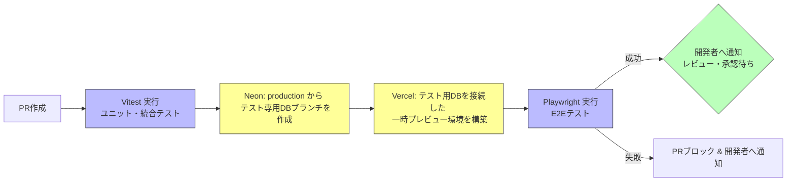
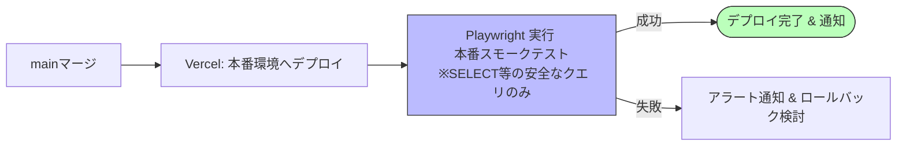

# 診療材料新規申請受付システム

## 1. 概要 & 解決する課題
- **背景:** 現職において市立病院の「診療材料審査委員会」事務局を担当した実務経験をベースに作成。
- **解決策:** アナログな申請プロセスの非効率さや、類似品目の増加によるコスト増大を解消するため、申請システム内に「価格比較によるプレゼン免除判定ロジック」を実装。

## 2. 技術スタック
| 領域 | 技術 | 選定理由（概要） |
| :--- | :--- | :--- |
| Frontend | Next.js (App Router) | 以前Laravelで苦戦した経験から、フォルダ構造がそのままURLになる直感性と、主流のフレームワークである点から採用。 |
| DB / ORM | Neon + Drizzle | 過去のレンタルサーバー運用時に苦労したため、DBはクラウドサービスを活用。Neonのブランチ機能によるCIの軽さを重視。Supabaseも検討したが後述の理由により却下。ORMはコードの見やすさで選択。 |
| Auth | Clerk | DBとAuthをSupabaseにまとめることも検討したがGUI上の設定方法が分からず頓挫。多機能サービスの複雑な設定を避け、分かりやすい認証専用サービスであるclerkを選択。 |
| Test / QA | Vitest + Playwright | 主流であること、テストの干渉しにくさに加え、`codegen` によるテストコード自動生成の効率性を評価し採用したものの、実際には`codegen`はほとんど使用せず。|
| CI/CD & Hosting | GitHub Actions + Vercel | Next.js開発元によるトラブル回避、およびプレビュー環境・E2Eテスト・デプロイの自動化を実現するため。 |

## 3. 品質保証 (QA) & CI/CD パイプライン
開発から本番デプロイまでの検証コストをゼロにし、堅牢性を担保する自動化フローを構築しています。

### ① PR段階の自動検証フロー

### ② マージ後・本番デプロイフロー

## 4. 技術的挑戦と問題解決
- **課題①: 初期セットアップ後の画面フリーズ（「登録中...」からの遷移不良）**
  - **発生原因:** ユーザーがフォームから送信した際、データベース（DB）側へのレコード登録自体は正常に完了していたが、Next.js（App Router）側で `/` のサーバーキャッシュが破棄されず、画面遷移後も古い「未登録状態のキャッシュ」がそのまま参照されていたため。
  - **解決策:** Server ActionでのDB登録処理直後に `revalidatePath('/')` を実行し、古いキャッシュを即時破棄。さらに `export const dynamic = 'force-dynamic';` を付与して動的評価を強制し、遷移を安定化。
- **課題②: 要求仕様に対するリソース最適化とスコープ制御**
  - **発生背景:** 認証基盤（Clerk）において、**個別実装したサインアップ動線側がうまく動作しないトラブルに直面**。調査の結果、そもそも「サインイン画面」のUIからサインアップ（新規登録）も兼ねられる仕様であることが判明した。
  - **解決策:** アプリ側で個別のサインアップ用ボタンを維持する必要性が低いと判断し、不要なボタンを画面から削除（Scope out）。限られた開発期間の中で、最優先事項である「QA・テスト自動化環境の構築」へリソースを集中投下。
